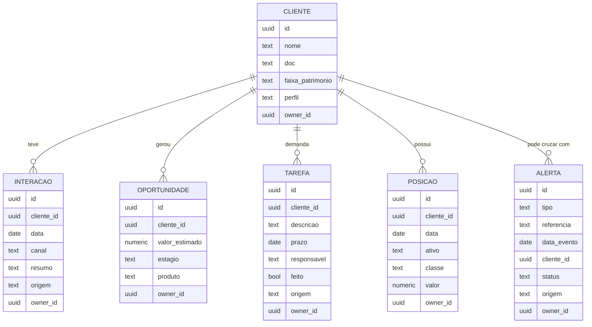

# PRD — O Sistema que Você Vai Construir no Curso

> [!abstract] Este documento é seu
> Este arquivo é a especificação do sistema que você vai construir ao longo
> dos 11 encontros. Não é um resumo do curso — é o seu **projeto**: o que
> construir, em que ordem, com quais regras.
>
> **Você vai manter dois repositórios Git** — um para a sua base de
> conhecimento (`consultor-wiki`) e outro para o sistema propriamente dito
> (`consultor-mont`). **Guarde este arquivo na raiz do repositório do
> sistema, como `PRD.md`.** Ele tem dois leitores: você, que decide o que
> fazer a cada encontro; e o seu agente de código, que lê este arquivo
> antes de qualquer tarefa para saber o que construir. É assim que você e
> o agente ficam alinhados do primeiro ao último encontro — e é assim que
> você se mantém alinhado com o resto da turma, mesmo que vinte pessoas
> estejam construindo em paralelo.

> [!tip] Uma analogia para a primeira leitura
> Pense neste PRD como a planta de uma casa que você está construindo em
> mutirão com a turma. A seção 6 é a **fundação** — você não reforma por
> capricho próprio. A seção 7 é o **cronograma da obra** — o que você já
> deve ter erguido, encontro por encontro. A seção 8 são as **regras de
> segurança do canteiro** — valem o tempo todo, para todo mundo. E a seção
> 13 tem duas partes: durante a obra (E07–E11) você já escolhe a cor de uma
> porta ou outra, mas a planta continua a mesma; só depois que a obra
> entrega as chaves é que você reforma a casa do seu jeito.

## 0. Como usar este documento

- **Nos encontros E01–E06, não edite as seções 1 a 9.** Elas valem para
  toda a turma. Se achar que alguma coisa está errada ou incompleta, traga
  para a aula — não mude por conta própria.
- **Do E07 ao E11, você ganha pontos pontuais de escolha própria**
  (um indicador e um alerta extra no E07, uma ferramenta MCP no E10) — mas
  as seções 1, 2 e 4 continuam as mesmas até o fim do curso. A bifurcação
  completa deste PRD só acontece depois que o curso termina. Ver seção 13.
- **A seção 14 (Status por Encontro) é sua para atualizar.** É o seu
  checklist vivo — marque o que concluiu ao final de cada encontro.
- **Ao começar cada encontro, peça ao seu agente:** *"Releia o `PRD.md`,
  me diga em qual encontro estamos pela seção 14, e o que falta implementar
  até o final de hoje."*
- **Ao terminar cada encontro, peça ao seu agente:** *"Atualize a seção 14
  do `PRD.md` marcando o que concluímos hoje."*

### Quando o PRD e o seu código divergirem

Vai acontecer — em onze encontros com um agente de código, é normal. O que
importa é o que você faz quando perceber:

1. **Antes de decidir de memória, rode a verificação:** *"Rode a operação
   `verificar` do `CLAUDE.md` e me liste toda divergência entre o projeto e
   o `PRD.md`."* (a operação está descrita na seção 10 — você mesmo a
   escreve no seu `CLAUDE.md`)
2. **Se o seu código está certo e o PRD ficou velho** (por exemplo, você já
   tem uma coluna que o PRD não lista) — até o E06, leve isso para a aula
   em vez de editar por conta própria as seções 1–9. Depois do curso, você
   já pode atualizar a seção direto
3. **Se o PRD está certo e o seu código desviou** (por exemplo, uma tabela
   sem `owner_id`, ou um fluxo sem revisão humana no caminho crítico) —
   peça ao agente para alinhar o código ao PRD, com o diff mostrado antes
   de aplicar qualquer mudança. Nunca deixe o agente decidir sozinho qual
   dos dois prevalece
4. **Nunca ignore a divergência.** Um PRD que não reflete o seu sistema é
   pior do que não ter PRD nenhum — ele te dá uma confiança que não devia
   ter

## 1. Visão geral do que você vai construir

Um sistema proprietário de **CRM + dashboard + alertas**, para você, como
consultor de valores mobiliários independente. Ele substitui a planilha, a
agenda e o CRM alugado por um sistema que você mesmo constrói, hospeda e
opera — com código no seu próprio repositório, banco de dados próprio, e um
agente de código que vai continuar ajudando você a estender esse sistema
depois que o curso terminar.

Esse sistema mora no seu repositório `consultor-mont`, separado da sua
base de conhecimento (`consultor-wiki`, que você começa no E03). Os dois
se conversam — o sistema lê alguns arquivos da wiki — mas são projetos
diferentes, com históricos de Git diferentes. A seção 10 detalha a divisão.

**O compromisso deste curso com você:** você não vai aprender a *usar*
ferramentas de IA — vai aprender a *construir* a sua própria ferramenta,
com um agente de código ao seu lado. Este PRD é o que sustenta esse
compromisso na prática: sem ele, "construir junto com a turma" vira "cada
um construindo uma coisa diferente" — e você perde a referência de onde
deveria estar a cada semana.

**Nome do seu projeto por enquanto:** `consultor-mont`. Use este nome até
o fim do curso (E11). Só depois do curso, na bifurcação de verdade da
seção 13, você renomeia para o que fizer sentido para o seu negócio.

## 2. Quem usa o sistema

| Papel | Quem é | Acessa o sistema? |
|---|---|---|
| **Consultor** | Você, o dono da conta | Sim — login único, dono de todos os dados que cria |
| **Cliente da sua consultoria** | A pessoa que você atende | **Não.** É registro no sistema, nunca usuário logado nesta fase |

Por enquanto, o sistema é de um usuário só — o seu. Não existe conceito de
equipe, multiempresa ou cliente com login próprio ainda — ver seção 4
(fora de escopo).

## 3. As fases do curso, e o que você pode mudar em cada uma

| Fase | Encontros | O que vale |
|---|---|---|
| **Fundação compartilhada** | E01–E06 | Este PRD, seções 1–9, igual para toda a turma. Você não personaliza nada ainda — nem entidade, nem escopo |
| **Extensões aditivas** | E07–E11 | A arquitetura e o escopo (seções 1, 2, 4, 5, 6, 9, 10) continuam os mesmos. Você acrescenta pontos específicos — um indicador e um alerta extra no E07, uma ferramenta MCP própria no E10 — mas não reescreve sua visão nem seu escopo ainda |
| **Sua personalização real** | Depois do curso (sessão de 30 dias, e além) | Você bifurca o PRD de verdade (seção 13): reescreve visão, usuário e escopo para evoluir o sistema do seu jeito |

Essa divisão existe por um motivo simples: até o E06 você ainda não tem
repertório para decidir o que faz sentido mudar, e cada aluno "querendo a
sua entidade própria" cedo demais tira a turma do rumo. A partir do E07
você já constrói sobre uma base sólida, e pode começar a imprimir a sua
cara — ver o detalhe de cada ponto na seção 13.

## 4. O que você vai construir (e o que não)

### Dentro do escopo

- Autenticação de usuário único (e-mail/senha via Supabase Auth)
- CRUD de cliente, interação, oportunidade, tarefa, posição
- Importador de CSV de posição de corretora, agendado, idempotente
- Dashboard com 4 indicadores + 1 série externa (SGS/Banco Central)
- 1 alerta configurado (CVM 358 ou equivalente)
- 1 fluxo de automação (transcrição → interação/tarefa) com revisão humana
- 1 ferramenta MCP própria exposta ao agente
- Sistema publicado em domínio próprio, com SSL

### Fora de escopo por agora

- Multiempresa / múltiplos consultores na mesma instância
- Cliente com login próprio ou portal do cliente
- Aplicativo mobile nativo
- Envio automático de mensagem sem revisão humana (ver seção 8 — é regra
  arquitetural do sistema, não uma limitação temporária)
- Integração automática com WhatsApp além de exportar/colar conversa — a
  API oficial tem custo por mensagem; pergunte ao professor antes de tentar
  ir além disso
- Self-hosted de qualquer peça da stack (Supabase, n8n, hospedagem) — use
  os serviços gerenciados, a não ser que o professor oriente o contrário

## 5. Com o que você vai construir

| Camada | O que você usa | Por quê |
|---|---|---|
| Agente de código | **Claude Code** | É o que você instalou e vem usando desde o E02 |
| Linguagem/framework | **Next.js + TypeScript + React** | A base de todo código que o seu agente vai gerar |
| Banco de dados | **Supabase** (Postgres + Auth + RLS) | É onde todo o seu dado mora a partir do E05 |
| Hospedagem | **Vercel** (ou a plataforma que o professor indicar) | Confirme com o professor antes do E11 |
| Versionamento | **Git + GitHub**, dois repositórios separados | Você aprende isso no E04, e vê a divisão em dois repositórios na seção 10 |
| Automação | **n8n Cloud** | Introduzido no E06, aprofundado no E08 e E09 |
| Telas (alternativa) | **Lovable**, conectado ao mesmo Supabase | Caminho B do E05, se preferir |
| Construção de MCP | **Claude Code / SDK de MCP** | É o que você constrói no E10 |

**Regra de ouro:** antes de adotar qualquer ferramenta nova, depois do
curso ou durante ele, responda às **três perguntas do E01** — onde o dado
fica, quem acessa, por quanto tempo.

## 6. O que você vai modelar, automatizar e expor (a fundação)

### Suas tabelas

Você vai criar cinco entidades de negócio no E05, mais uma de sistema
(`alerta`, que entra no E07). Todas vivem no banco Supabase do repositório
`consultor-mont`. **Modelagem é decisão de negócio, não de tecnologia** —
se achar que falta algo, traga para a aula; não mude por conta própria até
o E06.



### Regras obrigatórias em todas as suas tabelas

| Coluna | Em quais tabelas | Para quê serve |
|---|---|---|
| `owner_id` | **Todas, sem exceção** — incluindo `alerta` | Sustenta a política de RLS que você cria no E05: "você só lê e escreve onde `owner_id` é o seu uid" |
| `origem` | `interacao`, `tarefa`, `alerta` (e qualquer tabela que receba registro de fluxo automatizado) | Rastreabilidade — qual fluxo criou o registro e quando, no formato `e09-transcricao-AAAA-MM-DD`. Deixe em `null` quando você mesmo criar o registro à mão. **Em `alerta`, nunca deixe em `null`** — todo alerta nasce de um fluxo |

> [!danger] Se você escolheu o Caminho B (Lovable) no E05
> As regras acima valem também para você. O Lovable pode propor migrações
> próprias no seu Supabase — **recuse** qualquer migração que remova
> `owner_id`, desative RLS, ou mude a chave de deduplicação de `posicao` ou
> `alerta`, mesmo que ela venha descrita como "melhoria". Leia a migração
> antes de aprovar, do mesmo jeito que você já faz com o seu agente de
> código: ler, propor, executar.

### Decisões de modelagem que já estão fechadas

Não reabra estas decisões até o E07:

- **`faixa_patrimonio`, não `patrimonio`.** Guarde faixa, não valor exato —
  a mesma régua de anonimização do E01. Se precisar do valor exato, ele
  está em `posicao`
- **Identificador de ativo com sigla estável**, mantido em
  `ativo-sinonimos.csv`, dentro de `raw/` **no repositório `consultor-wiki`**
  — não é tabela do banco, é um arquivo que você vai alimentando conforme
  usa (E06). Seu importador, no `consultor-mont`, lê esse arquivo do outro
  repositório — por isso as duas pastas ficam lado a lado (seção 10)
- **Chave de unicidade de `posicao`:** `(cliente_id, ativo, data)` — é o
  que sustenta a idempotência da sua carga (E06)
- **Chave de deduplicação de `alerta`:** `(tipo, referencia, data_evento)`
  — mesmo padrão de upsert da `posicao`, para você não se notificar duas
  vezes do mesmo evento (E07)
- **IDs são `uuid`, nunca sequencial** — evita que alguém descubra quantos
  clientes você tem só olhando o endereço (E05)

### Os fluxos de automação que você vai construir (n8n)

Você constrói três fluxos, em três encontros diferentes, **ampliando o
mesmo canvas a cada um** (E06 → E08 → E09). Não crie um fluxo novo sem
registrar o que ele faz aqui primeiro.

| Fluxo | Quando você constrói | Gatilho | O que ele lê | Como evita duplicar | Para para revisão? | O que ele produz |
|---|---|---|---|---|---|---|
| `carga-posicao` | E06 | Diário, dia útil, 6h | CSV de corretora em `raw/` do `consultor-wiki` | Chave `(cliente_id, ativo, data)` | Não — determinístico; mas sempre mostra um relatório antes de gravar | Upsert em `posicao`, no `consultor-mont` |
| `carga-alerta-cvm358` | E07 | Diário, 6h (um nó a mais no fluxo acima) | Arquivo do Formulário 358, Portal de Dados Abertos CVM | Chave `(tipo, referencia, data_evento)` | Não — mas só te avisa quando cruzar com ativo de algum cliente seu | Insere em `alerta` quando há cruzamento |
| `transcricao-interacao` | E08, com a revisão ligada no E09 | Novo arquivo `.txt` na pasta de transcrições | Transcrição + seu `CLAUDE.md` + sua tabela `cliente` | A mesma transcrição processada duas vezes não pode gerar duas interações | **Sim, sempre que for crítico** — se ficou ambíguo quem é o cliente, ou surgiu uma tarefa com prazo, o fluxo para e espera você | `interacao` + `tarefa`, ambas com `origem` |
| `reativacao-rede` | E09 | Semanal, domingo 20h | Clientes seus sem interação há mais de 60 dias + a última interação registrada + `padroes/padrao-marca.md` do `consultor-wiki` | Um cliente só reaparece depois de nova janela de 60 dias sem contato | **Sim, sempre** — mensagem a cliente é sempre crítica (seção 8) | `interacao` registrando o envio, com `origem` |

**Regra permanente:** sempre que mexer num fluxo, exporte o `.json` do n8n
e commite no repositório `consultor-mont`, na pasta `fluxos/`. É o que traz
esse fluxo para dentro da sua rede de segurança do Git — um fluxo que só
existe no canvas do n8n não tem `git checkout` se você quebrar alguma
coisa.

### As ferramentas MCP que você vai expor

No E10 você expõe ao seu agente ferramentas que ele passa a poder
**executar**, não só descrever. Pelo menos uma é obrigatória; a segunda é
sugestão.

| Ferramenta | O que ela recebe | O que ela devolve | Autenticação | Você precisa construir? |
|---|---|---|---|---|
| `criar_tarefa` | `cliente_id`, `descricao`, `prazo`, `prioridade` | id da tarefa criada + link do seu CRM | Token pessoal, nunca direto no código | **Sim** — mínimo do E10 |
| `resumo_mensal_cliente` | `cliente_id`, `mes` | Texto de resumo a partir de `interacao` e `posicao` do período | Token pessoal | Não — é a sugestão do pré-work, mas pode trocar por outra da sua rotina |

**Toda ferramenta que você construir segue a mesma anatomia:** nome,
**descrição explícita de quando usar**, entrada, saída, autenticação. Se a
descrição ficar vaga ("cria tarefa"), o seu agente não vai chamá-la, ou vai
chamar na hora errada — o mesmo problema da anatomia do pedido que você
viu no E01, agora aplicado à ferramenta.

## 7. O que entra no seu sistema, encontro por encontro

Use esta tabela como checklist de ritmo — **se um encontro não aparece
aqui implementado, você ainda não deveria ter construído**. Não adiante, e
não se preocupe se ainda não chegou lá.

| Encontro | O que você constrói | Tabelas/arquivos que mudam |
|---|---|---|
| E01–E02 | Nada ainda — fundamentos e setup do seu ambiente | — |
| **E03** | `CLAUDE.md`, `raw/`, `wiki/`, `padroes/` — sua base de conhecimento, sem aplicação ainda. **Repositório `consultor-wiki`** | Arquivos, não banco |
| **E04** | Git inicializado no `consultor-wiki`; nenhuma funcionalidade nova | — |
| **E05** | **Repositório `consultor-mont` criado** — banco modelado (5 tabelas + RLS), autenticação, 4 telas do CRM (listagem, ficha, cadastro, funil) | `cliente`, `interacao`, `oportunidade`, `tarefa`, `posicao` (schema) |
| **E06** | Importador de CSV de posição, normalizado, validado, idempotente, agendado via n8n | `posicao` (dados, em `consultor-mont`), `ativo-sinonimos.csv` (em `consultor-wiki`) |
| **E07** | Dashboard (4 indicadores padrão + SGS) **+ 1 indicador e 1 alerta extra, da sua escolha** (seção 13); fluxo `carga-alerta-cvm358` | `alerta` (schema + dados); consultas sobre `posicao` |
| **E08** | Fluxo `transcricao-interacao`: identifica cliente → gera interação (rascunho) → extrai tarefas (rascunho). Para na revisão | `interacao`, `tarefa` (como rascunho) |
| **E09** | Ponto de revisão humana ativo (só no caminho crítico); coluna `origem` em uso; fluxo `reativacao-rede` | `interacao`, `tarefa`, `alerta` (coluna `origem`) |
| **E10** | MCP próprio — `criar_tarefa` obrigatória **+ ao menos 1 ferramenta da sua escolha** (seção 13); segredos em variável de ambiente; backup testado | Nenhuma tabela nova — infraestrutura |
| **E11** | Sistema publicado no seu domínio, variáveis de ambiente em produção, DNS, SSL | Deploy — nenhuma tabela nova |

## 8. As regras de governança de IA que você segue sempre

Esta é a regra que resume tudo, e vale para qualquer funcionalidade nova
que você propuser depois do curso:

> **IA transforma e sugere; o banco calcula; você decide.**

| Onde | Pode entrar IA? |
|---|---|
| Resumir suas interações em texto corrido | Sim |
| Sugerir próximo passo com base no histórico | Sim, como sugestão |
| Redigir rascunho de mensagem | Sim, com sua revisão |
| Classificar interação por assunto | Sim |
| Calcular indicador do seu dashboard | **Não** — isso é consulta ao banco |
| Decidir adequação de produto a um cliente | **Não** — essa decisão é sua |
| Enviar qualquer coisa ao cliente sozinha | **Não** |
| Apagar ou alterar registro histórico | **Não** |

### O que você revisa antes de sair, e o que segue direto

| Crítico — para e espera sua aprovação | Não crítico — salva direto como rascunho rotulado |
|---|---|
| Qualquer coisa que vai ao seu cliente | Resumo interno de reunião |
| Tarefa com prazo que se torna um compromisso seu com o cliente | Classificação por assunto |
| Qualquer coisa que embasa uma recomendação de produto | Sugestão de próximo passo que só você vê |
| Edição ou exclusão de registro histórico | — |

Duas regras que você nunca quebra, em encontro nenhum:

1. **Nada gerado por IA vai ao seu cliente sem você revisar.**
2. **Todo registro criado por um fluxo carrega `origem`** — isso é
   automático, você não precisa pedir.

Nunca implemente aprovação automática por decurso de prazo ("se eu não
aprovar em 24h, manda assim mesmo") — a justificativa completa está no
material do E09.

## 9. O que seu sistema precisa garantir, sempre

### Segurança e dado

- **Nenhum dado real de cliente entra em ferramenta de chat genérica**, em
  encontro nenhum — regra permanente desde o E01
- **Dado real só entra no seu sistema a partir do E06** (seu RLS já está
  ativo desde o E05, e você já testou com dois usuários)
- RLS ativo em **todas** as suas tabelas, com a mesma regra: o dono do
  dado é quem inseriu (`owner_id = auth.uid()`)
- Toda API externa que você chamar tem cache obrigatório (regra do E07,
  escrita no seu `CLAUDE.md`)
- Toda carga que você rodar (CSV, fluxo) é idempotente e mostra relatório
  antes de gravar (regra do E06)
- Segredo nunca vai para nenhum dos seus dois repositórios — use variável
  de ambiente, `.env` no `.gitignore`, e a chave `service_role` nunca sai
  do servidor (E10/E11)

### Regulatório

Duas normas diferentes aparecem ao longo do curso — não confunda uma com
a outra:

**Resolução CVM 19/2021**

| Artigo | O que exige | Onde o seu sistema atende |
|---|---|---|
| Art. 16 | Informação verdadeira, completa, consistente, não indutora de erro | As regras de gráfico que você segue no E07; a regra de citação do E03 |
| Art. 17 | Sistema auditável; automação não mitiga a sua responsabilidade | O ponto de revisão humana que você constrói no E09; o código fica nos seus repositórios, não num produto fechado |
| Art. 23 | Guarda mínima de 5 anos da documentação que fundamentou recomendações | A retenção de dado que você mantém (não "apague o quanto antes"); a coluna `origem`; o backup que você testa no E10 |

**Instrução CVM 358**

| Artigo | O que exige | Onde o seu sistema atende |
|---|---|---|
| Art. 11 | Base do Formulário 358 — administradores de companhia aberta negociando valores mobiliários da própria companhia | O fluxo `carga-alerta-cvm358` e a tabela `alerta` que você constrói no E07 |

### Operação

- Backup automático do Supabase, com **você testando a restauração ao
  menos uma vez**
- Uma página de saúde básica do seu sistema, no ar
- Teste de sucessão: se o seu notebook quebrasse hoje, recriar o sistema
  deveria exigir só clonar os seus dois repositórios e configurar as
  variáveis de ambiente — nada que viva só na sua cabeça ou só na sua
  máquina

## 10. Como você organiza os seus dois repositórios

Você mantém **dois repositórios Git separados**, cada um com um papel
diferente — por isso não moram na mesma pasta:

| Repositório | Nasce em | Guarda |
|---|---|---|
| `consultor-wiki` | E02/E03 | Sua base de conhecimento: fontes brutas, páginas da wiki, modelos de comunicação |
| `consultor-mont` | E05 | O sistema: aplicação, banco, fluxos exportados, ferramentas MCP — e este `PRD.md` |

> [!important] Mantenha as duas pastas lado a lado no seu computador
> Por exemplo, dentro de uma pasta `mont/` contendo `consultor-wiki/` e
> `consultor-mont/`. Alguns fluxos do sistema leem arquivos da wiki — o
> importador do E06 lê `ativo-sinonimos.csv`, a reativação de rede do E09
> lê `padrao-marca.md` — e isso só funciona se as duas pastas estiverem
> acessíveis uma da outra, no mesmo computador.

### `consultor-wiki/` — sua base de conhecimento

```
consultor-wiki/
├── CLAUDE.md                # instrução persistente deste repositório
├── raw/                      # suas fontes brutas — você nunca deixa o agente editar aqui (E03)
│   └── ativo-sinonimos.csv    # sigla de ativos; lido pela ingestão do consultor-mont (E06)
├── wiki/                      # sua base de conhecimento, mantida pelo agente (E03)
├── padroes/                   # carta-mensal.md, follow-up.md, resumo-reuniao.md, padrao-marca.md (E03)
└── archive/                   # o que você não usa mais no dia a dia
```

### `consultor-mont/` — o seu sistema

```
consultor-mont/
├── PRD.md                   # este documento
├── CLAUDE.md                 # instrução persistente deste repositório
├── app/                       # código da sua aplicação — Next.js (a partir do E05)
├── supabase/                   # suas migrations e schema (a partir do E05)
├── fluxos/                      # .json exportado de cada fluxo n8n (a partir do E06)
├── .env.example                 # nomes das variáveis, nunca os valores
├── .gitignore                    # inclui .env desde o início
└── package.json
```

### O `CLAUDE.md` da sua wiki (construído no E03)

```markdown
# CLAUDE.md

Este arquivo orienta o agente de código que trabalha neste repositório —
a minha base de conhecimento, não o sistema (esse é outro repositório,
consultor-mont).

## O que é este repositório
Minha base de conhecimento como consultor de valores mobiliários. A
informação entra bruta, é organizada, e é consultada depois para produzir
peças de comunicação com cliente — ou para alimentar automações do
sistema.

## Estrutura de pastas
raw/, wiki/, padroes/, archive/

## Como escrever em `wiki/`
Uma página por assunto. Toda afirmação cita a fonte em `raw/`.
Se não está em `raw/`, escreva "não consta".

## O que nunca entra
Nome, CPF, e-mail, telefone, conta de cliente. Valor exato de patrimônio —
use faixa. Recomendação de produto a cliente específico é decisão minha,
nunca do agente.

## Operações
- ingest — leio um arquivo de raw/, atualizo wiki/, listo o que mudou
- query — respondo com base em wiki/, citando páginas
- lint — reviso wiki/ procurando contradição, página órfã e afirmação sem
  citação

## Regras de trabalho
- Proponha antes de alterar arquivo existente. Criar arquivo novo pode.
- Ao terminar uma ingestão, diga em uma linha o que ficou de fora e por quê.
```

### O `CLAUDE.md` do seu sistema (construído a partir do E05)

```markdown
# CLAUDE.md

Este arquivo orienta o agente de código que trabalha neste repositório —
o meu sistema, não a minha base de conhecimento (essa é outro
repositório, consultor-wiki).
Leia também o `PRD.md` antes de qualquer tarefa nova.

## O que é este repositório
[do E05] Meu sistema proprietário de CRM, dashboard e alertas.

## Estrutura de pastas
[do E05] app/, supabase/, fluxos/

## Modelo de dados
[do E05] Cinco tabelas: cliente, interacao, oportunidade, tarefa, posicao.
Toda tabela tem owner_id. RLS: dono do dado é quem inseriu. Ver PRD.md
seção 6 antes de propor mudança de schema.

## Regras de carga e integração
[do E06] Toda carga é idempotente, chave (cliente_id, ativo, data).
Toda carga emite relatório de inconsistência antes de gravar.
Leio ativo-sinonimos.csv do repositório consultor-wiki (pasta raw/).
[do E07] Toda chamada a API externa tem cache.

## Governança de IA
[do E09] IA transforma e sugere; o banco calcula; eu decido.
Nada gerado por IA vai ao cliente sem minha revisão.
Todo registro criado por fluxo automatizado grava `origem`.

## Segredos
[do E10] Segredo nunca vai no repositório. Variável de ambiente sempre.
Chave service_role nunca sai do servidor.

## Operações
- verificar — comparo o schema, os fluxos (seção 6 do PRD.md) e as
  ferramentas MCP atuais contra o que o PRD.md descreve, e listo toda
  divergência encontrada, sem corrigir nada sem minha aprovação

## Regras de trabalho
- Proponha antes de alterar arquivo existente. Mostre o SQL antes de executar
  migração. Criar arquivo novo pode.
- Ao terminar uma tarefa, diga em uma linha o que ficou de fora e por quê.
```

### Como nomear as coisas

- Tabelas e colunas do banco: `snake_case`, em português
- Componentes de código: `PascalCase`
- Mensagem de commit, em cada repositório: complete a frase *"se eu voltar
  para esta foto, eu volto para quê?"* (regra do E04)
- Um arquivo de padrão por peça de comunicação em `padroes/` — nunca
  misture carta, follow-up e ata no mesmo arquivo (E03)

## 11. Como saber se você está no ponto certo, encontro por encontro

| Encontro | Pronto quando... |
|---|---|
| E05 | Suas 5 tabelas têm `owner_id`; RLS está ativo; você testou com dois usuários e nenhum viu o dado do outro |
| E06 | Importar o mesmo CSV duas vezes não duplica; o relatório aparece antes de gravar; seu fluxo agendado rodou ao menos uma vez |
| E07 | Seus 4 indicadores calculam sobre `posicao`; cada indicador mostra de quando é o dado; seu alerta passou pelos 3 critérios (existe ação, você quer saber hoje, não dispara demais) |
| E08 | Seu fluxo roda completo até o ponto de parada; rodar a mesma transcrição duas vezes não duplica; você commitou o `.json` do fluxo |
| E09 | O nó de revisão humana só aparece no caminho crítico; `origem` está preenchida em todo registro criado por fluxo |
| E10 | Seu MCP é chamável pelo agente; segredos estão fora dos dois repositórios; você restaurou o backup ao menos uma vez em teste |
| E11 | Seu sistema está no ar, no seu domínio; as variáveis estão cadastradas na plataforma; o SSL está ativo |

## 12. Como montar os seus dois repositórios, passo a passo

> Pré-requisito: Claude Code instalado e funcionando (E02).

### Repositório 1 — sua base de conhecimento (E02/E03)

1. **Crie a pasta e entre nela**
   ```
   mkdir consultor-wiki && cd consultor-wiki
   ```

2. **Abra o Claude Code**
   ```
   claude
   ```

3. **No E03, peça ao agente:** *"Crie as pastas `raw/`, `wiki/`,
   `padroes/` e `archive/`. Crie um `CLAUDE.md` seguindo o modelo da seção
   10 do `PRD.md` do curso — a parte do `consultor-wiki`."*

4. **No E04, inicialize o Git**
   ```
   git init
   git add .
   git commit -m "ponto de partida da wiki"
   ```

### Repositório 2 — o seu sistema (a partir do E05)

5. **Mantenha as duas pastas lado a lado.** Por exemplo, crie uma pasta
   `mont/` e deixe `consultor-wiki/` dentro dela — o repositório do sistema
   vai nascer ao lado, no próximo passo.

6. **Clone o repositório-base do sistema**
   ```
   git clone <repo-base-fornecido-pelo-curso> consultor-mont
   cd consultor-mont
   ```

   > [!tip] Ainda não recebeu o repositório-base?
   > Sem problema — você mesmo monta a pasta:
   > ```
   > mkdir consultor-mont && cd consultor-mont
   > git init
   > ```
   > Copie este `PRD.md` para a raiz. Depois peça ao agente: *"Crie as
   > pastas `app/`, `supabase/` e `fluxos/`. Crie um `CLAUDE.md` seguindo o
   > modelo da seção 10 deste `PRD.md` — a parte do `consultor-mont`."*

7. **Abra o Claude Code na pasta do sistema**
   ```
   claude
   ```
   Primeiro pedido: *"Leia o `PRD.md` e o `CLAUDE.md` desta pasta e me
   explique em três frases o que vamos construir."*

8. **Crie o seu projeto no Supabase** (a partir do E05)
   - Crie sua conta e um projeto novo, região São Paulo
   - Anote a URL do projeto e a chave `anon` (pública)

9. **Configure suas variáveis de ambiente**
   ```
   cp .env.example .env
   ```
   Peça ao agente: *"Me explique, uma por uma, o que preciso preencher no
   `.env` e onde encontro cada valor no painel do Supabase."* **Nunca
   commite o `.env`** — já vem no `.gitignore`.

10. **Rode localmente**
    ```
    npm install
    npm run dev
    ```
    Abra `localhost:3000` e confirme que carrega.

11. **Conecte ao GitHub** (E04 — se o clone não vier conectado)
    ```
    git remote add origin <url-do-seu-repositorio>
    git push -u origin main
    ```

12. **Publique na plataforma gerenciada** (só no E11)
    - Conecte o repositório `consultor-mont` à Vercel (ou equivalente)
    - Cadastre as variáveis de ambiente nas configurações do projeto
    - Aponte o domínio que você registrou para a plataforma

13. **Repita o ritual a cada encontro** — ver seção 0.

## 13. Como personalizar o seu sistema

### Durante o curso (E07–E11): você soma, não reescreve

A partir do E07, você já começa a ter escolhas próprias — mas são
**pontuais, somadas à base que você já tem**, nunca uma reescrita deste
PRD:

| Encontro | O que você acrescenta | O que continua igual |
|---|---|---|
| E07 | 1 indicador extra no seu dashboard + 1 alerta extra, da sua escolha | Os 4 indicadores padrão, o SGS, o alerta CVM 358, o schema |
| E08 | — | Fluxo de transcrição completo |
| E09 | — | Revisão humana, reativação de rede |
| E10 | Ao menos 1 ferramenta MCP da sua escolha (ex.: `criar_tarefa`, `resumo_mensal_cliente`, ou outra da sua rotina) | A arquitetura de MCP, a regra de segredos |
| E11 | O conteúdo da sua apresentação final | O processo de publicação, DNS e SSL |

**As seções 1, 2 e 4 deste PRD não mudam entre o E07 e o E11.** Você ainda
constrói o mesmo sistema da turma; o que varia são só os pontos marcados
acima. Se sentir vontade de reescrever sua visão ou seu escopo antes do
fim do curso, **espere** — é exatamente o risco que o E05 já havia
nomeado, e ele só deixa de ser risco depois do E11.

### Depois do curso: a sua bifurcação de verdade

Só a partir daqui — na sessão de acompanhamento de 30 dias, ou depois —
você deixa de seguir este PRD ao pé da letra e passa a **bifurcá-lo** para
o seu próprio negócio.

**O que fazer:**

1. Este arquivo já está na raiz do seu repositório `consultor-mont` como
   `PRD.md` — a partir de agora, pare de tratá-lo como somente-leitura
2. Reescreva as **seções 1 (visão), 2 (usuário) e 4 (escopo)** com o que
   você quer que o seu sistema seja a partir de agora
3. **Mantenha as seções 5, 6, 9 e 10** (arquitetura, modelo de dados,
   requisitos não-funcionais, convenções) — são a sua fundação, e mudá-las
   sem necessidade quebra o que você já construiu
4. Peça ao agente: *"Atualizei a visão e o escopo do `PRD.md`. Releia e me
   diga se alguma funcionalidade nova que eu descrevi conflita com o
   modelo de dados ou as regras de governança das seções 6, 8 e 9."*
5. Renomeie o repositório do sistema, se quiser (`consultor-mont` → o nome
   do seu negócio). A sua wiki pode continuar com o nome que já tem — é
   mais pessoal, menos ligada à marca do produto

**O que você ganha com isso:** você não está só recebendo um sistema
pronto — está aprendendo a **escrever a especificação de um sistema**, que
é a habilidade que sobra quando o curso acaba e você quer construir a
próxima coisa sozinho.

## 14. Seu status, encontro por encontro

> Atualize esta seção ao final de cada encontro. É o seu checklist vivo.

- [.] E01 — Fundamentos e Modelo Mental
- [.] E02 — Diferenciar Ferramentas e Setup
- [.] E03 — LLM Wiki e Agente de Código
- [.] E04 — Git e Versionamento
- [.] E05 — Modelagem de Dados e CRM
- [.] E06 — Ingestão e Tratamento de Dados
- [.] E07 — Dashboard, APIs e Alertas
- [.] E08 — Automação e Fluxo de Transcrição
- [.] E09 — Revisão Humana e Reativação de Rede
- [.] E10 — MCP Próprio e Operação
- [.] E11 — Publicação, DNS e Apresentação Final
