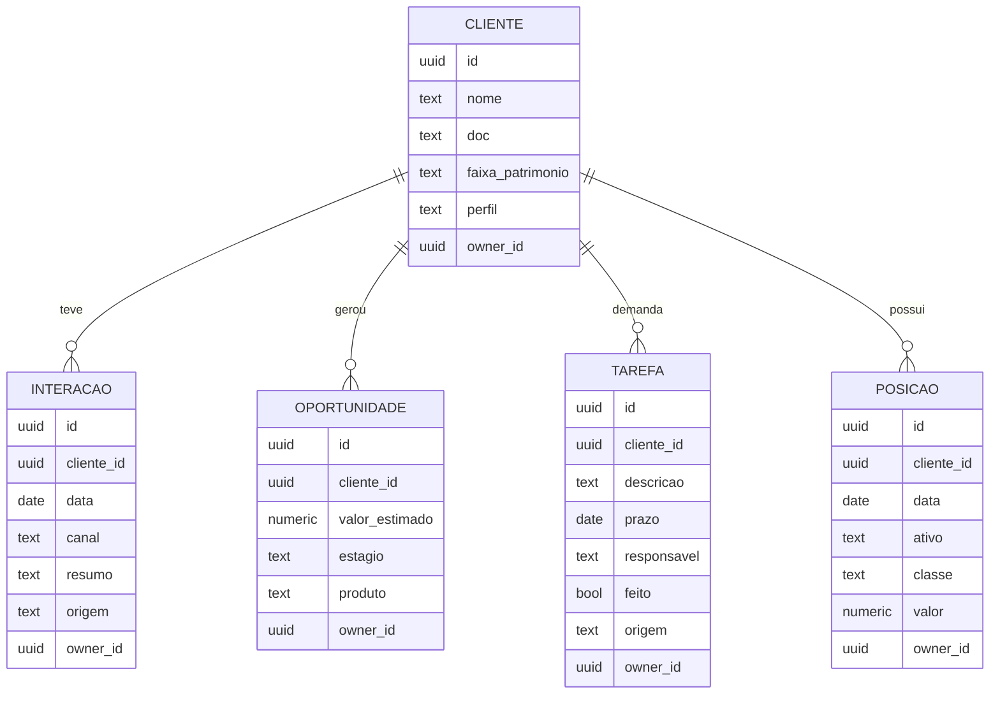

# entidades.md — as cinco tabelas do `consultor-mont`

> **Artefato do Encontro 05.** Descreve as cinco entidades de negócio que o
> prompt [`enviar-modelagem-supabase.md`](../prompts/enviar-modelagem-supabase.md)
> espera encontrar em `entidades.md`, na pasta do curso. Fonte: o diagrama ER
> da seção 6 do `PRD.md`. Projeto Supabase de referência: **"Sistema Mont"**
> (`uwzgihzgcsztsqnbrvgz`).

## Diagrama



## Regras obrigatórias

- **`owner_id` em todas as cinco tabelas, sem exceção** — sustenta a política de RLS: você só lê e escreve onde `owner_id` é o seu `auth.uid()`.
- **`faixa_patrimonio` é `text` (faixa, não valor exato)** — nunca uma coluna numérica de patrimônio.
- **`origem`** existe em `interacao` e `tarefa` para rastrear qual fluxo automatizado criou o registro. `null` quando o registro foi criado à mão.
- Relacionamento por `cliente_id` (uuid), referenciando `cliente(id)`, nas quatro tabelas filhas.

## SQL completo

```sql
create table public.cliente (
  id                uuid primary key default gen_random_uuid(),
  nome              text not null,
  doc               text,
  faixa_patrimonio  text,          -- faixa, não valor exato
  perfil            text,
  owner_id          uuid not null default auth.uid()
);

create table public.interacao (
  id          uuid primary key default gen_random_uuid(),
  cliente_id  uuid not null references public.cliente(id),
  data        date,
  canal       text,
  resumo      text,
  origem      text,                -- null quando criado à mão
  owner_id    uuid not null default auth.uid()
);

create table public.oportunidade (
  id               uuid primary key default gen_random_uuid(),
  cliente_id       uuid not null references public.cliente(id),
  valor_estimado   numeric,
  estagio          text,
  produto          text,
  owner_id         uuid not null default auth.uid()
);

create table public.tarefa (
  id          uuid primary key default gen_random_uuid(),
  cliente_id  uuid not null references public.cliente(id),
  descricao   text,
  prazo       date,
  responsavel text,
  feito       boolean not null default false,
  origem      text,
  owner_id    uuid not null default auth.uid()
);

create table public.posicao (
  id          uuid primary key default gen_random_uuid(),
  cliente_id  uuid not null references public.cliente(id),
  data        date,
  ativo       text,
  classe      text,
  valor       numeric,
  owner_id    uuid not null default auth.uid()
);

create index on public.interacao     (cliente_id);
create index on public.oportunidade  (cliente_id);
create index on public.tarefa        (cliente_id);
create index on public.posicao       (cliente_id);
```

> Este SQL ainda não foi executado no projeto Supabase. Siga os passos 1–4 do
> prompt de modelagem para criar as tabelas, ativar autenticação e ligar o RLS
> antes de inserir qualquer dado.
